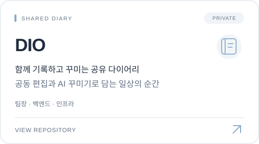
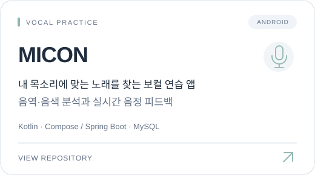
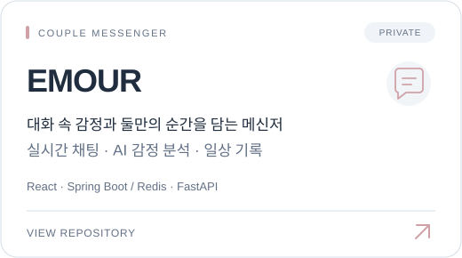
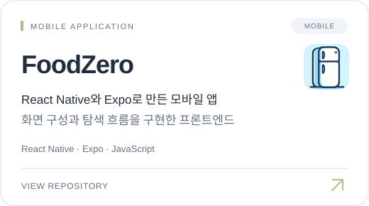

<!--
**Seungmin903/Seungmin903** is a ✨ _special_ ✨ repository because its `README.md` (this file) appears on your GitHub profile.

Here are some ideas to get you started:

- 🔭 I’m currently working on ...
- 🌱 I’m currently learning ...
- 👯 I’m looking to collaborate on ...
- 🤔 I’m looking for help with ...
- 💬 Ask me about ...
- 📫 How to reach me: ...
- 😄 Pronouns: ...
- ⚡ Fun fact: ...
-->

  ### _💎✨Seungmin's coding Activity✨💎_

 

 

## Projects
함께 만든 서비스와 직접 쌓아온 경험

  <a href="https://github.com/Seungmin903/DIO"><picture><source media="(prefers-color-scheme: dark)" srcset="./assets/projects/dio-dark.svg" /></picture></a>
  <a href="https://github.com/Seungmin903/MICON"><picture><source media="(prefers-color-scheme: dark)" srcset="./assets/projects/micon-dark.svg" /></picture></a>

  <a href="https://github.com/Seungmin903/EMOUR"><picture><source media="(prefers-color-scheme: dark)" srcset="./assets/projects/emour-dark.svg" /></picture></a>
  <a href="https://github.com/Seungmin903/SM-project-FE"><picture><source media="(prefers-color-scheme: dark)" srcset="./assets/projects/foodzero-dark.svg" /></picture></a>

Earlier work &nbsp;·&nbsp; <a href="https://github.com/Seungmin903/SoftwareEngineeringProject">Todolist</a> — 소프트웨어공학 팀 프로젝트

